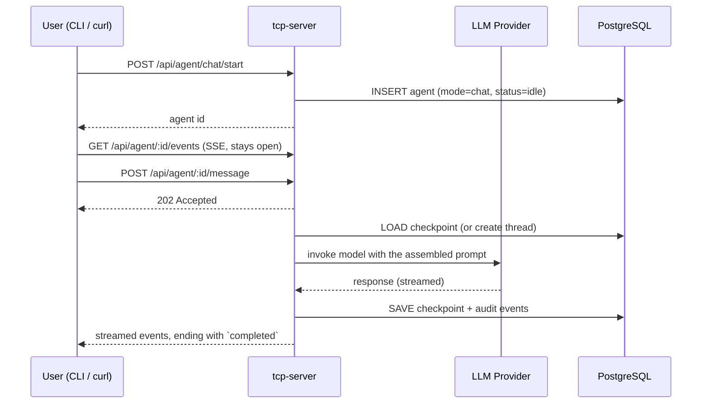

# Section 3 — Chat Agents

[← Back to start](./start.md#sections)

> **Requires:** Section 2 complete — `$COMPANY_ID` and `$ROLE_ID` set.

You are testing the interactive chat flow. A chat agent is a persistent conversation thread backed by LangGraph: each message is appended to the checkpoint and the model sees the full history. tcp-server runs the turn inline (not via tcp-agent), returns `202` immediately, and streams everything the turn does over SSE.

Every route below is JWT-guarded — `$TCP_TOKEN` from [start.md](./start.md#useful-aliases) must be set.



---

## 3.1 — Create a chat agent

```bash
AGENT_ID=$(curl -s -X POST http://localhost:3000/api/agent/chat/start \
  -H "Authorization: Bearer $TCP_TOKEN" \
  -H "Content-Type: application/json" \
  -d "{
    \"companyId\": \"$COMPANY_ID\",
    \"roleId\": \"$ROLE_ID\"
  }" | jq -r '.id')

echo "Agent ID: $AGENT_ID"
```

Expected response:

| Field          | Expected                                   |
| -------------- | ------------------------------------------ |
| `id`           | A UUID string                              |
| `status`       | `"idle"`                                   |
| `threadId`     | `null` (nothing checkpointed yet)          |
| `assignmentId` | A UUID — every agent carries an assignment |

The agent's `chat` **mode** lives on that assignment, not on the agent (see
[tasks.md → Agent modes](../tasks.md#agent-modes)). There is no `type` field.

---

## 3.2 — Send the first message

The message triggers prompt assembly (parts 0–8: system prompt, role persona, company context, services list, the assignment presentation, RAG results, final instruction) and stores the conversation in a LangGraph checkpoint. The POST returns immediately; the turn itself runs detached.

```bash
curl -s -o /dev/null -w '%{http_code}\n' \
  -X POST "http://localhost:3000/api/agent/$AGENT_ID/message" \
  -H "Authorization: Bearer $TCP_TOKEN" \
  -H "Content-Type: application/json" \
  -d '{"message": "Hello! Who are you and what can you help me with?"}'
```

**What to check:**

- The status code is **202**, and the body is `{"accepted":true}`.
- Nothing else comes back on this request — the reply arrives on the SSE stream (section 3.6) or through the CLI (section 3.7). There is no `response` or `compactionReport` field on any HTTP response; the compaction summary rides on the terminal `completed` event.

---

## 3.3 — Send a follow-up message

Send a second message. The model now has the full conversation history from the LangGraph checkpoint and should refer back to what was said.

```bash
curl -s -X POST "http://localhost:3000/api/agent/$AGENT_ID/message" \
  -H "Authorization: Bearer $TCP_TOKEN" \
  -H "Content-Type: application/json" \
  -d '{"message": "What did I just ask you?"}'
```

Expected: on the stream (or in the CLI), the model correctly recalls the previous message ("You asked who I am and what I can help you with" or similar).

---

## 3.4 — Check the agent status

```bash
curl -s "http://localhost:3000/api/agent/$AGENT_ID" \
  -H "Authorization: Bearer $TCP_TOKEN" \
  | jq '{status, threadId}'
```

| Field      | Expected                                             |
| ---------- | ---------------------------------------------------- |
| `status`   | `"idle"` (returns to idle after each turn)           |
| `threadId` | A non-null UUID (the LangGraph checkpoint thread ID) |

---

## 3.5 — Check audit events

Every LLM request and response is written to the audit log, which is also what the CLI replays as history:

```bash
curl -s "http://localhost:3000/api/agent/$AGENT_ID/history" \
  -H "Authorization: Bearer $TCP_TOKEN" \
  | jq '[.[] | {eventType, role}]'
```

Expected: events in chronological order including `input` (your message), `llm_request`, `llm_response`, and `state_change` entries — one set per message sent.

## 3.6 — Watch the raw event stream (optional)

Subscribe to the SSE stream directly to see what the CLI renders. In one
terminal, open the stream; in another, send a message.

```bash
# Terminal 1 — watch the stream (stays open):
curl -sN "http://localhost:3000/api/agent/$AGENT_ID/events" \
  -H "Authorization: Bearer $TCP_TOKEN"

# Terminal 2 — send a message (returns 202 immediately):
curl -s -X POST "http://localhost:3000/api/agent/$AGENT_ID/message" \
  -H "Authorization: Bearer $TCP_TOKEN" \
  -H "Content-Type: application/json" \
  -d '{"message": "Tell me a short story."}'
```

Expected on the stream: a sequence of `data:` events. Most are audit rows
(`{"type":"audit","event":{…}}` — `input`, `state_change`, `llm_request`,
`llm_response`), interleaved with live-only `reasoning`/`response` token deltas
where the provider streams them, ending with a terminal `state_change`.
Reconnecting after the turn has finished still delivers a synthesized terminal
event, replayed from the stored output.

---

## 3.7 — Streamed rendering via the CLI

Run an interactive session. The output is colour-coded scrolling text.

```bash
./tcp-cli.sh chat --role-id "$ROLE_ID"
```

**What to check:**

- Colour-coded, blank-line-separated blocks appear: **Agent state** (cyan),
  **LLM state** (magenta), **Reasoning** (grey, indented), **Response** (white).
- No raw/unformatted event JSON leaks into the output.
- `--hide-reasoning` suppresses the reasoning block; the response still renders.
- **Stray-`>` check:** after each turn completes, exactly **one** `> ` prompt is
  shown — never a duplicate or an orphaned prompt while the model is still
  working. Run several turns, including one that triggers a consultation, and one
  where you press **Ctrl+C mid-turn** (which should stop watching, print that the
  agent continues server-side, and re-show a single prompt).
- **Ctrl+C at the idle prompt** cleans up the agent and exits. Typing `exit` or
  `quit` ends the session the same way.
- **Consultation lines:** when the agent consults another role, you see
  `consultation:asked <Role>` with the question, then
  `consultation:<Role> answered` (or `couldn't answer`) with the text. The
  consulted agent's own activity is followed on stderr.

**What to check (web UI, consultation):**

Open a chat with a role that can consult another (for example, ask a chat agent
something only another role can answer).

- The transcript shows an "Asked {Role}" entry with the question, and a
  "{Role} is working on it…" line under it.
- When the other role finishes, the waiting line goes and a "{Role} answered"
  entry (or "{Role} couldn't answer") appears with the text. The asking agent
  then carries on.
- Click "Open conversation with {Role}". The consulted agent's conversation
  opens read-only, and its first message is the question.
- A screen reader announces "Consulting {Role}" and "{Role} answered", without
  reading out the body.

`scripts/manual-verify.sh` automates the consultation scenario (`-r 4` runs just
the consultation prompt) and asks these as yes/no checks.

---

[Continue to Section 4 → Autonomous Agents](./04-autonomous-agents.md)
