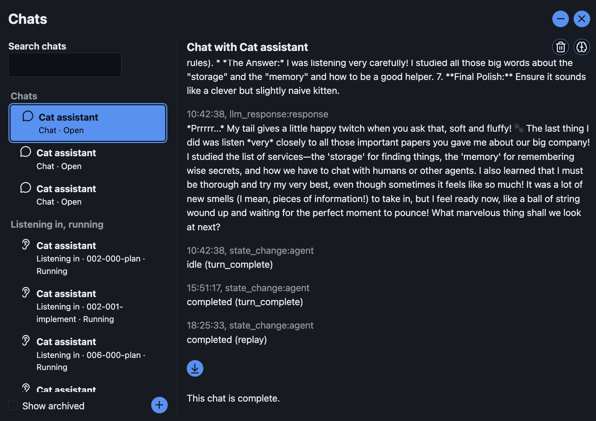
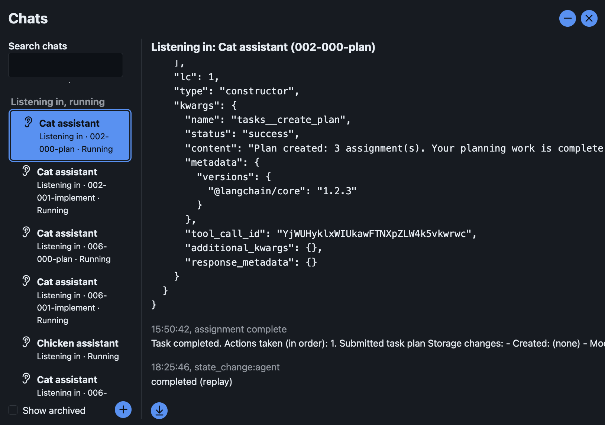

Some further feedback...

Please create a plan to address the feedback below.

Remain on branch `04/000-06_chat-dialog-refresh`, continue to create commits there.

When done, push and update the PR.

## Action button spacing

Please tweak the action buttons in the tray - they should all have a little space between them.

## Chat dialog transcript rendering

Please also review and improve the rendering of the transcripted content in the chat dialog:

- Content in reasoning and responses should be treated as markdown and rendered as markdown, even while being streamed
- Content has line breaks, and hopefully these will also be respected when presented as markdown
- The tool calls and responses are currently rendered as preformatted json
  - Instead interpret the toolcall json and render a block of just the key informatino, eg.

    Request:

    > | Request field | Value                |
    > | ------------- | -------------------- |
    > | Tool name     | `tasks__create_plan` |
    > | Input         | See full JSON >>     |
    >
    > See full JSON>>

    Response:

    > | Response field | Value                                                          |
    > | -------------- | -------------------------------------------------------------- |
    > | Tool name      | `tasks__create_plan`                                           |
    > | Status         | success                                                        |
    > | Content        | Plan created: 2 assignment(s). Your planning work is complete. |
    >
    > See full JSON >>

- In most conversations, although the normal transcript word-wrapped, the view has accidentally become wide - perhaps because of preformatted tool calls. Hopefully the new formatting will resolve this.

Do we need a markdown rendering library?

## Chat dialog items list

The chat dialog items list doesn't seem to be doing a great job of tracking eavesdrops and chats. I suspect this has something to do with how archived / hidden chats are tracked.

Please refer to the dev instance, test company (simple-company) which is currently running for the issues mentioned below.

| Chats                                                                                                                                                              | Listening in                                                                                                                                        |
| ------------------------------------------------------------------------------------------------------------------------------------------------------------------ | --------------------------------------------------------------------------------------------------------------------------------------------------- |
|  |  |

- I don't see a button to hide / archive an eavesdrop on a finished assignment (and I'd guess the same is true for active assignments)
- when I archived a chat with Cat Assistant, the archive button disappeared (I think? I don't recall - it's not there now) - but the chat itself continued to be shown
- All 3 chats with Cat Assistant seem to be treated the same
- The listings for all 3 chats with Cat Assistant seem very similar - is there anything we can use to distinguish them?
- Checking/unchecking the show archived option below the list didn't seem to make a difference
- All 3 chats with Cat Assistant show as Open, but if I archived one, it ought not to be open any longer?
- All the listening in items are listed as 'running' - but they are finished, something isn't updating as expected?
- All the listening items look very similar when rendered - this makes it hard to tell them apart. What do you recommend?

Please investigate and come back with your explanation of what the issue is, and how we can make this more intuitive / work as intended.
