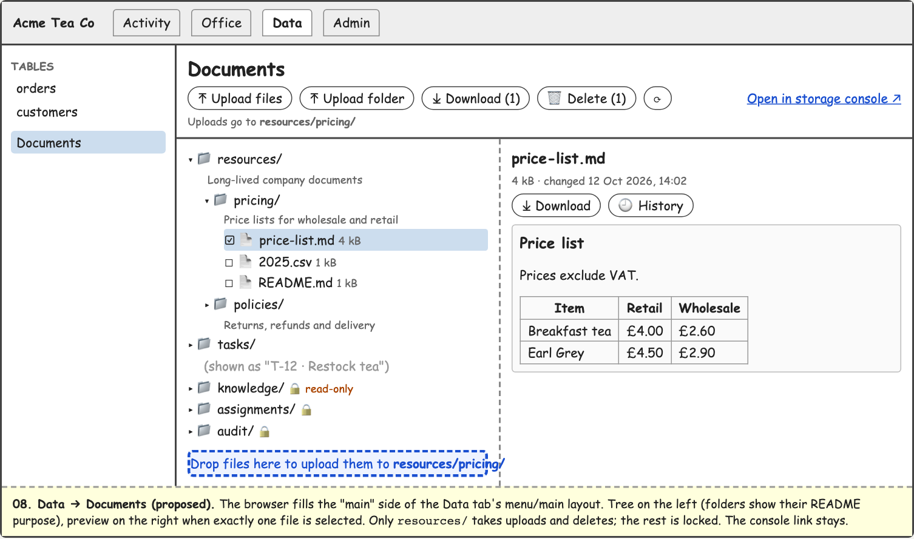
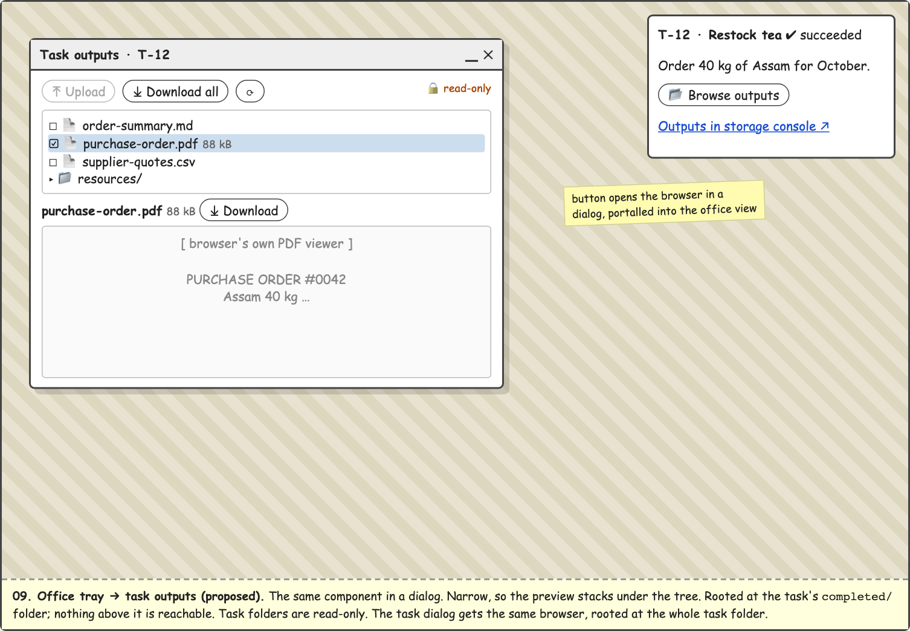
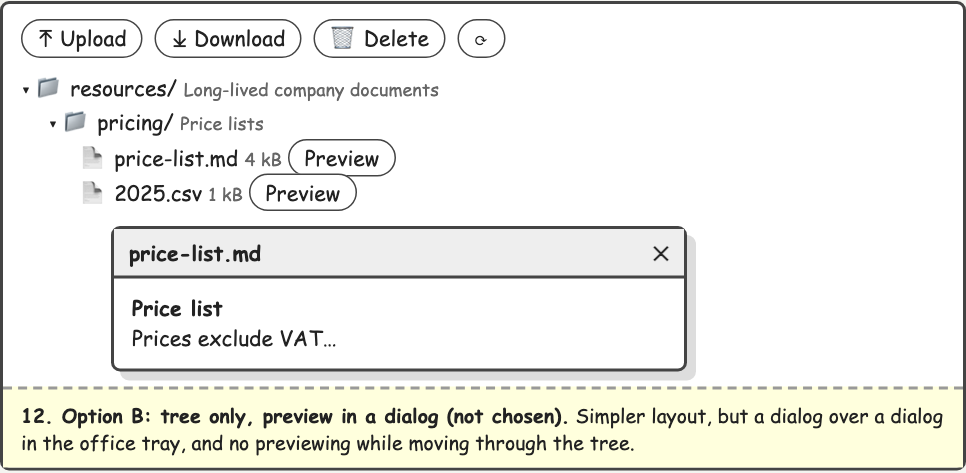
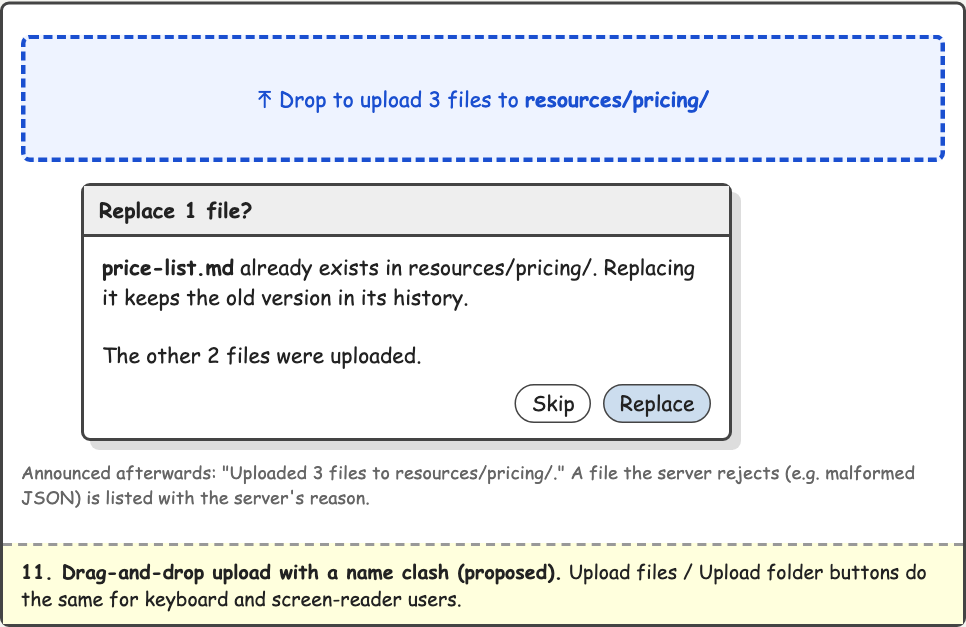
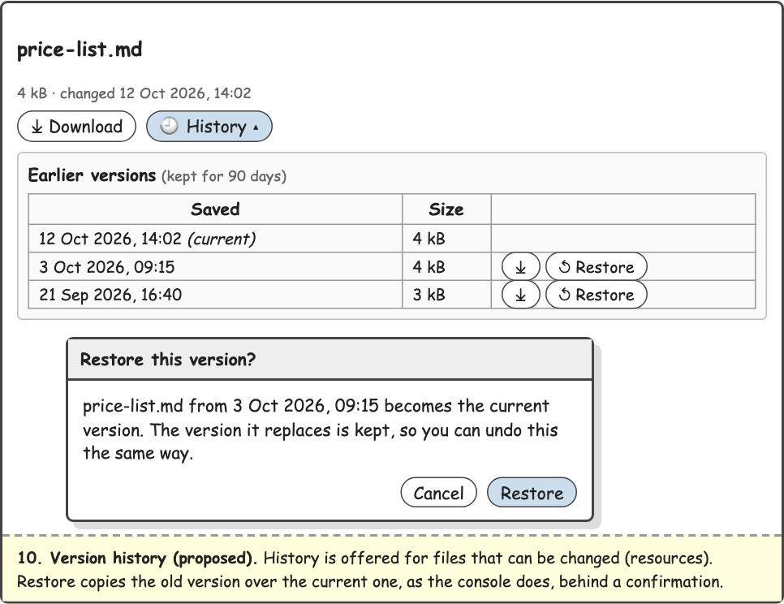

# 002.05 — Web UI storage browser

- **Branch:** `04/002-05_web-ui-storage-browser`, cut from `origin/phase-04` (fetch first). The PR targets `phase-04`.
- **Commits:** one per stage, made once that stage's gate passes. Stage files by name only: the user is editing upcoming prompts while this runs, and those edits stay out of every commit.
- **Orchestrator:** Opus. Sub-agents per the [model allocation](#model-allocation) table.

Guidance read: `AGENTS.md`, `dev-qual/skills/plan-work/SKILL.md`, `dev-qual/guidance/process/before-coding.md`, `docs/prompts/phase 02 - web ui/model-allocation.md`, `docs/shared-storage.md`, and the 002.04 plan (for format). Each stage reads `dev-qual/guidance/process/before-coding.md` and `dev-qual/guidance/standards/testing.md` first. Stages 3–5 also read ADR-026 and ADR-027.

## Context

Parity row 8: the CLI can upload and download shared documents, but the web client only links out to the Silo console. This plan adds an in-app storage browser: a folder tree, a read-only preview, download (one file, several, or folders), upload (files, folders, drag and drop), delete, and version history with restore for company resources. The console links stay.

### What exploration found

- **Storage already does most of it.** `StorageService` (`apps/backend/apps/tcp-server/src/storage/storage.service.ts`, abstract) and `MinioStorageAdapter` (`storage/minio-storage.adapter.ts`) have list, `getByKey`, `putByKey` (validates, audits, reindexes), soft-delete `deleteFile` (copies to `_deleted/`), and `restoreFile`. `S3ObjectStore` (`storage/s3-object-store.ts`) wraps the S3 client. **Nothing lists or reads old versions**, and nothing lists one folder level (`ListObjectsV2` without `Delimiter`).
- **The human route is by raw key.** `StorageProxyController` (`api/storage-proxy.controller.ts`): `GET/POST /api/storage?path={slug}/…`, company-checked through `@CompanyScope({ via: 'storagePath' })`. Any member can write anywhere in their company through it, knowledge included. The CLI uses it; this plan leaves it alone.
- **Folder purpose** is the first non-empty line of the folder's `README.md`, with leading `#` stripped: `purpose()` in `apps/backend/apps/tcp-mcp-storage/src/mcp/resource-tools.service.ts:450-465`.
- **Zip:** `fflate` is already a backend dependency; `records-api.service.ts:293` uses `zipSync`. `records.controller.ts:95-114` has `sendAttachment`, which writes to `res` directly because `MaskSecretsInterceptor` flattens a `StreamableFile`.
- **Frontend has everything needed.** React Aria Components 1.20 has `Tree` (with `hasChildItems` and `TreeLoadMoreItem`), `DropZone`, `FileTrigger` (`allowsMultiple`, `acceptDirectory`) and `Toolbar`. `Markdown` (`src/components/Transcript/Markdown.tsx`) renders GFM. Also available: `getBlob`, `postJsonForBlob` and `postFile` (`src/api/client.ts`), `saveBlob` (`src/api/hooks.ts`), and `ConfirmDialog` and `Dialog` (`src/components/Dialog/`). Browsers show images and PDFs natively.
- **Current console links:** `DocumentsPanel.tsx` (Data → Documents: a table of links), `TaskDetails.tsx` (`OutputsLink`, a succeeded task's outputs), `ArchiveDetails.tsx` (each archived task). All are built by `src/api/storageLink.ts`.
- **Knowledge already has its own upload door:** `KnowledgePanel.tsx` uploads through the knowledge routes, which convert to OKF and reindex.

### Decisions agreed with you (2026-10-18)

| Decision           | Choice                                                                                                                                                 |
| ------------------ | ------------------------------------------------------------------------------------------------------------------------------------------------------ |
| Layout             | Two panes: tree, and a preview when exactly one file is selected. The preview stacks under the tree when the host is narrow (dialog, tray).            |
| Writable folders   | `resources/` only. Upload, delete and restore are refused everywhere else, **by the server**. The UI shows those folders locked.                       |
| Knowledge          | Read-only in Data → Documents. `KnowledgePanel` stays the only upload door. Uploading knowledge from the browser goes to a new draft prompt (stage 6). |
| How storage is met | New company-scoped backend routes. MinIO stays internal, and no S3 credential or presigned URL reaches the browser.                                    |

The layout option not chosen:

### Mockups

Sketches, in `docs/prompts/phase 04 - utility/illustrations/` (embedded where each is referred to):

- 08 — Data → Documents (`08.storage-browser.documents.proposed.png`): the browser in a menu/main layout's main side.
- 09 — Office tray → task outputs (`09.storage-browser.office-dialog.proposed.png`): the same component in a dialog, stacked, read-only.
- 10 — Version history and restore (`10.storage-browser.history.proposed.png`).
- 11 — Drag-and-drop upload with a name clash (`11.storage-browser.upload-conflict.proposed.png`).
- 12 — Option B, not chosen (`12.storage-browser.option-b-preview-dialog.png`): tree only, preview in its own dialog.

### Choices made in the design (say if you disagree)

1. **No new libraries.** The tree, drop zone and file picker come from React Aria. Previews use what is installed or native: `Markdown` for `.md`, a small CSV parser and a `<table>` for `.csv`, `<pre>` for text, `` for images, and `<iframe>` for PDF (the browser's own viewer). Office files (Word, Excel, PowerPoint, OpenDocument) get "No preview" and a download button **in this work**, because agents can't read them yet (see below). The Office preview library arrives with the new 002.11 prompt (stage 6).

   **Can agents use Office files today? No:**
   - **Knowledge:** `.docx` (and `.pdf`) uploads are converted to OKF Markdown by `knowledge-conversion.ts` (mammoth, pdf-parse), and the original is not kept. Knowledge folders never hold an Office file. `.xlsx`, `.pptx` and OpenDocument aren't accepted at all.
   - **Resources:** `resource-tools.service.ts:27-40` lists `doc/docx/xls/xlsx/ppt/pptx` (and `pdf`) as binary, and `read_resource` refuses them ("can't be read as text").
   - **Shared storage and task materials:** `POST /api/task/:id/materials` stores the file as uploaded. `read_file` and `read_material_file` read through `getText`, which decodes the bytes as UTF-8, so an Office file comes back as noise. PDF materials look the same way, which contradicts 006.02's "storage tools handle text and PDFs". The 002.11 prompt should verify this first.

   So by your rule this goes to a future prompt (stage 6): **002.11, Office documents for agents**. It covers text extraction for `read_file`, `read_material_file` and `read_resource`; knowledge conversion for the other formats; and the browser's Office preview, added then.

2. **The root is a view, not a security boundary.** A browser rooted at `tasks/{id}/completed/` never shows anything above it, but the server's boundary is the company folder. A member could reach the rest of their own company through Data → Documents anyway.
3. **Task folders are labelled.** In Data → Documents, `tasks/{uuid}/` shows as "T-12 · Restock tea", using the task list the panel already loads. Folders with no matching task (context overflow, deleted tasks) keep their raw name.
4. **Purposes only under `resources/`.** Reading every `README.md` costs one extra read per subfolder. Under `tasks/` that would be one read per task, for no gain. So `purpose` is filled only when listing a folder inside `resources/`.
5. **Name clashes are asked, not assumed.** Upload without `overwrite` returns 409 when the file exists. The browser collects the clashes and asks once: "Replace N files?" (mockup 11). Replacing is safe because the old version stays in the history.

   

6. **Delete is soft and confirmed.** It reuses `deleteFile` (moved to `_deleted/`). Deleting a folder deletes every file under it. The browser can't undo a delete; the confirmation says the files can be recovered from the storage console. In-app undelete is deferred.
7. **History and restore for writable files only.** Restore copies the old version over the current one, as a new version, through `StorageService`, so it is audited and reindexed. Old versions can be downloaded.

   

8. **Downloads are always attachments**, sent with `X-Content-Type-Options: nosniff`. The browser fetches them with its bearer token as blobs anyway, because an `` can't carry the token. HTML and SVG are never rendered as documents: HTML is shown as text, and SVG only through ``, where scripts can't run.
9. **Zip in memory, capped.** Several files or a folder download as one zip built with `zipSync`, refused with 413 above 200 MB in total. This is the same shape as 001.03's records export. `// ponytail:` stream the zip if a real download hits the cap.
10. **No live updates.** There's a Refresh button, and the browser refetches after its own changes. An agent writing a resource while the browser is open shows up on refresh. Deferred.
11. **Uploads run one at a time.** `// ponytail:` run a few at once if folder uploads feel slow.
12. **Drops go to the upload target.** That is the selected folder, or the folder of the selected file, or the root. It is shown under the toolbar ("Uploads go to resources/pricing/"). Dropping onto a particular folder in the tree is deferred.
13. **Any member can change resources**, as in 001.02 and 001.03. Roles and permissions come with 003.01 (action approval).

### Security notes

- Every route takes `:companyId` and declares `@CompanyScope({ from: 'param', key: 'companyId', via: 'company' })`, so `route-audit.spec.ts` covers it and `CompanyMembershipGuard` checks membership.
- Paths are relative to the company folder, and one function checks them before anything reaches S3. It refuses a leading `/`, any `\`, any `.` or `..` segment, empty segments (`//`), control characters, and more than 1,024 characters. The key is always `${company.slug}/${path}`.
- The writable rule (`path` under `resources/`, and not `resources/` itself for delete) is checked on the server for upload, delete and restore. The UI's lock icons only reflect it.
- The existing `POST /api/storage` still lets any member write anywhere in their company, knowledge included. It is the CLI's door and out of scope. It goes in `outstanding-issues.md` (stage 6) so it isn't forgotten.

## API

All under `api/company/:companyId/storage`. `path` is relative to the company folder. A folder path ends in `/`, and `''` is the company root.

| Method | Route                    | In                                    | Out                                                                                                                                                                    |
| ------ | ------------------------ | ------------------------------------- | ---------------------------------------------------------------------------------------------------------------------------------------------------------------------- |
| GET    | `/folder?path=`          | folder path                           | `StorageFolderDto`: `{ path, writable, folders: [{ path, name, purpose: string \| null }], files: [{ path, name, size, lastModified }] }`, folders then files, by name |
| GET    | `/file?path=&versionId=` | file path, optional version           | The file as an attachment (`filename*=UTF-8''…`), `nosniff`. 404 if missing                                                                                            |
| POST   | `/file?path=&overwrite=` | multipart `file`; `overwrite` boolean | 201 `{ path, size }`. 403 not writable, 409 exists and `overwrite` not `true`, 413 over 50 MB (`MAX_UPLOAD_BYTES`), 422 validation (existing body shape)               |
| DELETE | `?path=`                 | file or folder path                   | 204. 403 not writable, 404 nothing there                                                                                                                               |
| POST   | `/zip`                   | `{ root, paths: string[] }`           | zip attachment, entries named relative to `root`. 400 if a path isn't inside `root`, 404 none exist, 413 over 200 MB (`MAX_ZIP_BYTES`)                                 |
| GET    | `/versions?path=`        | file path                             | `StorageVersionDto[]`: `{ versionId, size, lastModified, isLatest }`, newest first, delete markers left out                                                            |
| POST   | `/restore`               | `{ path, versionId }`                 | 201 `{ path }`. 403 not writable, 404 unknown version                                                                                                                  |

## Model allocation

| Work                                          | Model  | Why                                                                             |
| --------------------------------------------- | ------ | ------------------------------------------------------------------------------- |
| Stage 1: backend routes, path rules, versions | Opus   | Authorisation and path safety: a mistake here crosses company folders           |
| Stage 2: frontend data layer                  | Sonnet |                                                                                 |
| Stage 3a: preview renderers                   | Sonnet |                                                                                 |
| Stage 3b: `StorageBrowser` component          | Opus   | Accessibility behaviour: tree keyboard model, focus after delete, announcements |
| Stage 4: wiring into hosts                    | Sonnet |                                                                                 |
| Stage 5: browser-tier spec                    | Sonnet | Opus reviews (accessibility assertions)                                         |
| Stage 6: docs, prompts, outstanding issues    | Sonnet | Opus reviews; Haiku runs and reports the final gate                             |

## Stages

### - [x] Stage 1 — Backend routes (Opus)

**Files**

- `apps/backend/apps/tcp-server/src/storage/s3-object-store.ts`: add
  - `listLevel(prefix): Promise<{ folders: string[]; files: _Object[] }>`: `ListObjectsV2Command` with `Delimiter: '/'`, following continuation tokens. `folders` are the `CommonPrefixes` keys.
  - `listVersions(key): Promise<ObjectVersion[]>`: `ListObjectVersionsCommand` with `Prefix: key`, following `KeyMarker`/`VersionIdMarker`, keeping only entries whose `Key === key`. Delete markers aren't in `Versions`, so they drop out.
  - an optional `versionId` on `get` (`GetObjectCommand.VersionId`) and on `copy` (`CopySource` + `?versionId=`).
- `storage.service.ts` (abstract) and `minio-storage.adapter.ts`: add
  - `listFolder(prefix)`, which filters `_deleted/` as `listFiles` does;
  - `listVersions(key)`;
  - `versionId?` on `getByKey`;
  - `restoreVersion(key, versionId, originators)`: copy that version over the key, then `recordAudit('restore_version', …, { versionId })`, then `triggerReindex(key)`. 404 when the version isn't found.
- New `apps/backend/apps/tcp-server/src/api/company-storage-paths.ts`:
  - `toCompanyKey(slug, path, kind: 'file' | 'folder')`, applying the rules under [Security notes](#security-notes). A `folder` path must be `''` or end in `/`; a `file` path must not end in `/`.
  - `isWritable(path)` and `MAX_ZIP_BYTES = 200 * 1024 * 1024`.
  - `purposeOf(readme: string): string`, a copy of the MCP server's three lines of purpose parsing. Don't import across apps.
- New `api/company-storage.controller.ts`: the seven routes in [API](#api).
  - Company lookup and `getCurrentUserId(req)` as `records.controller.ts` does.
  - Multipart upload copied from `storage-proxy.controller.ts:85-117`.
  - Copy `sendAttachment` from `records.controller.ts:102-114`, and add `nosniff` and an RFC 5987 filename.
  - Folder delete: `listFiles(prefix, { all: true })`, then `deleteFile` for each.
  - Zip: `listFiles(prefix, { all: true })` for folder paths, summing sizes before reading any bodies, then `zipSync`.
- New `api/dto/company-storage.dto.ts` (a `.dto.ts` name, so the Swagger plugin reads it): `StorageFolderDto`, `StorageFolderEntryDto`, `StorageFileEntryDto`, `StorageVersionDto`, `StorageZipRequestDto` and `StorageRestoreRequestDto`, with class-validator decorators (the global pipe whitelists).
- `api/api.module.ts`: register the controller.
- Regenerate `apps/frontend/tcp-frontend/src/api/schema.d.ts`: run `./scripts/start-deployment.sh --rebuild` first (otherwise it reads a stale image), then `npm run api:generate`. Run Prettier from the repo root.

**Found while implementing:**

- MinIO (Silo) keeps listing a prefix whose objects are all deleted, because in a versioned bucket they leave delete markers. So `listFolder` keeps only subfolders that still have a live object (`S3ObjectStore.hasObjects`, one `MaxKeys: 1` list per subfolder; there's a `ponytail:` note on the cost).
- `copy` now URL-encodes its source key, which S3 requires; before, a key with a space or `ü` would have failed.

**Tests**

- `api/company-storage-paths.spec.ts`:
  - accepts `''`, `resources/` and `resources/a b/ü.md`;
  - refuses `/x`, `a\b`, `../x`, `a/../b`, `./a`, `a//b`, `a\u0000b`, 1,025 characters, a folder without `/`, and a file with `/`;
  - `isWritable` is true for `resources/x.md` and `resources/a/`, and false for `resources`, `knowledge/x`, `tasks/…` and `''`;
  - `purposeOf('\n# Price lists\nmore')` is `'Price lists'`, and an empty README gives `''`.
- `storage/minio-storage.adapter.spec.ts`: `restoreVersion` copies with the version id, audits `restore_version` and reindexes; an unknown version gives 404.
- New `apps/backend/test/e2e/tcp-server/company-storage.e2e-spec.ts`, against real MinIO, with nested `describe`s (each `beforeAll` makes its own fixtures) and `app.listen(0)`. Cases:
  - The root listing shows `resources/`, and listing `resources/` shows a subfolder's purpose.
  - A non-member gets 403 on every route, and `path=../other/` gets 400.
  - Upload into `resources/` gives 201; into `tasks/x/`, 403. A second upload gives 409, then 201 with `overwrite=true`.
  - Download returns the bytes with `nosniff`.
  - A zip of a folder holds both files, named relative to `root`; a zip path outside `root` gives 400.
  - After an overwrite, versions lists 2, newest first. Restore makes the old content current, and versions then lists 3. Restore on `knowledge/…` gives 403.
  - Deleting a file removes it from the listing, and deleting a folder removes all its files. Deleting `resources/` itself gives 403.

**Gate**

- `./dev-qual/scripts/check.sh --fast`
- `npx jest apps/tcp-server/src/api/company-storage-paths.spec.ts apps/tcp-server/src/storage` (from `apps/backend`)
- `./scripts/run-e2e-tests.sh company-storage`
- `route-audit.spec.ts` passes.
- `grep -c "/api/company/{companyId}/storage" apps/frontend/tcp-frontend/src/api/schema.d.ts` is at least 5.

### - [x] Stage 2 — Frontend data layer (Sonnet)

**Files**

- `src/api/query-keys.ts`: `'storage'` joins `STATIC_ENTITIES`; `queryKeys.storageFolder`, `storageVersions` and `storageFile` follow the repo's `[entity, scope, params]` shape (`['storage', 'list' | 'history' | 'detail', { companyId, path }]`). Mutations invalidate `['storage']`. (Changed from `storageKeys.all` during implementation, to match the existing keys.)
- `src/api/endpoints.ts` (copy the shape of the knowledge hooks at `endpoints.ts:559-600`):
  - `useStorageFolder(companyId, path, enabled)`: `api.GET('/api/company/{companyId}/storage/folder')`.
  - `useStorageVersions(companyId, path, enabled)`.
  - `useStorageFileBlob(companyId, path, enabled)`: `getBlob(storageFilePath(companyId, path))`, `staleTime: 30_000`.
  - `useUploadStorageFile(companyId)`: `{ path, file, overwrite }` → `postFile(...)`.
  - `useDeleteStorage(companyId)` and `useRestoreStorageVersion(companyId)`.
  - Every mutation's `onSuccess` invalidates `storageKeys.all(companyId)`.
  - `storageFilePath(companyId, path, versionId?)`, which builds the query string with `URLSearchParams`.
- `src/api/hooks.ts`: re-export the above (components import only `hooks.ts`). Add `downloadStorageFile(companyId, path, versionId?)` (the file name is the last segment) and `downloadStorageZip(companyId, root, paths, name)`, both using `saveBlob` as `downloadTemplate` does (`hooks.ts:1453-1461`).

These are **not** `Live` hooks: storage isn't pushed.

**Tests:** in `src/api/endpoints.test.ts` / `hooks.test.tsx`, following their existing fetch-stub pattern:

- the folder URL and params;
- `storageFilePath` encodes `ü`, spaces and `#`;
- upload posts multipart to `…/file?path=…&overwrite=true`;
- a 409 surfaces as `ApiError` with `status === 409`;
- each mutation invalidates `['storage', companyId]`;
- `downloadStorageZip` posts `{ root, paths }`.

**Gate:** `./dev-qual/scripts/check.sh --fast`; `npx vitest run src/api` (from `apps/frontend/tcp-frontend`).

**Boundary:** no component changes.

### - [x] Stage 3a — Preview renderers (Sonnet)

**Files:** new `src/components/StorageBrowser/previewKind.ts`, `csv.ts`, `FilePreview.tsx` and `FilePreview.css`.

- `previewKind(name, size)` returns `'markdown' | 'csv' | 'text' | 'image' | 'pdf' | 'none' | 'tooLarge'`, by lower-cased extension:
  - markdown: `md`, `markdown`
  - csv: `csv`
  - text: `txt json jsonl yaml yml xml log html htm ini toml ts js css`
  - image: `png jpg jpeg gif webp avif svg`
  - pdf: `pdf`
  - anything else: `none`
  - Caps: 1 MiB for markdown, csv and text; 25 MiB for image and pdf. Over the cap gives `tooLarge`, and nothing is fetched (the size comes from the listing).
- `mimeFor(name)`: the image types (`svg` → `image/svg+xml`) and `application/pdf`. The blob is rewrapped with this type before `URL.createObjectURL`, and the URL is revoked on unmount or change.
- `parseCsv(text, maxRows = 500)`: RFC 4180 (quoted fields, `""` escapes, newlines inside quotes, CRLF). Returns `{ rows: string[][]; truncated: boolean }`.
- `FilePreview({ companyId, file })`, using `useStorageFileBlob`:
  - Markdown → `<Markdown text>`. Check that `Markdown.tsx` doesn't enable raw HTML; stop and report if it does.
  - CSV → `<table className="tcp-table">` with the first row as `<th scope="col">`, a caption naming the file, and "Showing the first 500 rows" when truncated.
  - Text → `<pre tabIndex={0} role="region" aria-label={name}>` (a focusable scroll region, for axe).
  - Image → ``. PDF → `<iframe title={name}>`.
  - `none` / `tooLarge` → a message and the download button.
  - Loading and errors use `LoadingState` / `ErrorState`.
- Strings in `src/strings.ts`: `storage.preview.none`, `storage.preview.tooLarge` (`{size}`), `storage.preview.truncated` (`{count}`), `storage.preview.loading` and `storage.preview.error`.

**Tests**

- `previewKind.test.ts`: every extension group, upper case, no extension, and both caps at the boundary ±1 byte.
- `csv.test.ts`: quotes, escaped quotes, an embedded newline, CRLF, a trailing newline, and truncation at `maxRows`.
- `FilePreview.test.tsx`: a markdown heading is rendered; an HTML file is shown as literal text, not markup; SVG goes into an ``; `tooLarge` makes no fetch; the object URL is revoked on unmount.

**Gate:** `./dev-qual/scripts/check.sh --fast`; `npx vitest run src/components/StorageBrowser`.

### - [ ] Stage 3b — `StorageBrowser` component (Opus)

**Files:** new `src/components/StorageBrowser/StorageBrowser.tsx`, `StorageBrowser.css`, `useUploads.ts` and `VersionHistory.tsx`; strings under `storage.*`.

- **Props:** `{ companyId, root: string, label: string, folderLabel?: (path: string) => string | undefined, portalContainer?: Element }`. `root` is `''` or a folder path.
- **Tree:** RAC `Tree`, `selectionMode="multiple"`, with paths as ids.
  - A folder is a `TreeItem` with `hasChildItems`. Its children render (via `useStorageFolder`) only while it is expanded, with a `TreeLoadMoreItem` while loading.
  - Rows show a name, a lock on non-writable folders, the purpose as `Text slot="description"`, and a size on files.
  - An empty root shows `EmptyState`.
- **Toolbar** (RAC `Toolbar`): Upload files (`FileTrigger allowsMultiple`), Upload folder (`FileTrigger acceptDirectory`), Download (count), Delete (count), Refresh.
  - Upload and Delete are disabled unless the target, or every selected item, is writable. The reason is given as a description.
  - The upload target is shown under the toolbar.
- **Layout:** `container-type: inline-size` on the browser: two columns from 720px, stacked below that. No prop.
- **Preview:** shown when exactly one file is selected. It has the name, size, date, Download, and History (writable files only). History is a disclosure holding `VersionHistory`: a table of versions with Download and Restore. Restore goes through `ConfirmDialog`. See mockup 10:

  

- **Uploads** (`useUploads`), as in mockup 11:

  

  - Files come from `FileTrigger` or `DropZone` (recurse `DirectoryDropItem.getEntries()`). Each path is the target plus the relative path (`webkitRelativePath` for folder picks).
  - One upload at a time.
  - 409s are collected into one `ConfirmDialog` (Replace / Skip). Other failures are listed with the server's message.
  - One announcement at the end ("Uploaded 3 files to resources/pricing/").

- **DropZone** wraps the tree pane. `getDropOperation` returns `'cancel'` when the target isn't writable.
- **Focus (ADR-027):** after a delete, focus returns to the tree; after a restore, to the History button. Dialogs return focus to their trigger.
- **Announcements:** one channel, `storage`, for upload, delete and restore results, through `announce`.

**Tests:** `StorageBrowser.test.tsx`, with real RAC widgets and stubbed fetch (never fake the widget API). Render in StrictMode (`renderAppAt` or the test helper that wraps it). Cases:

- Expanding a folder fetches its listing, and nothing above `root` is shown.
- `folderLabel` renames a folder.
- Selecting one file shows the preview; selecting two hides it.
- Upload and Delete are disabled in a locked folder.
- A 409 upload asks Replace and re-posts with `overwrite=true`; Skip doesn't re-post.
- A dropped folder uploads with its relative paths.
- Delete confirms, calls DELETE, returns focus to the tree, and announces.
- Restore confirms and announces.
- `axe` finds no violations at either width.

**Gate:** `./dev-qual/scripts/check.sh --fast`; `npx vitest run src/components/StorageBrowser`.

### - [ ] Stage 4 — Wire it in (Sonnet)

**Files**

- New `src/components/StorageBrowser/StorageBrowserDialog.tsx`: a `Dialog` (`heading`, `portalContainer`, `onClose`) around `StorageBrowser`. It minimises like every other dialog.
- `src/pages/CompanyPage/DocumentsPanel.tsx`:
  - Replace the link table with `<StorageBrowser root="" label={t('documents.heading')} folderLabel={…}>`. `folderLabel` maps `tasks/{id}/` to `t('documents.taskOutputs', { shortcode, request })`, using the tasks the panel already loads.
  - Keep the heading, and keep one "Open in storage console" link to the company root (`storageFolderUrl`) when the console is configured.
  - Remove the strings this leaves unused.

  

- `src/components/TaskDialog/TaskDialog.tsx`: after the assignments, add `<h3>{t('task.files.heading')}</h3>` and a `StorageBrowser` rooted at `tasks/${taskId}/`.
- `src/visualisation/isometric/company/ui/TaskDetails.tsx`: beside `OutputsLink`, for a succeeded task, add a "Browse outputs" button. It opens `StorageBrowserDialog` rooted at `tasks/${taskId}/completed/`, passing `portalContainer`.

  

- `ArchiveDetails.tsx`: each row gets a Browse button (accessible name `t('visualisation.archive.browse', { shortcode })`) that opens the same dialog. The console link stays when configured. Without the console, rows are no longer plain text.

**Tests:** update

- `DocumentsPanel.test.tsx`: the tree is shown, a task folder is labelled, and the console link is present only when configured;
- `TaskDialog.test.tsx`: the Files heading, and a tree rooted at the task;
- `TaskDetails.test.tsx` and `ArchiveDetails.test.tsx`: the button opens the dialog, inside the portal container.

**Gate:** `./dev-qual/scripts/check.sh --fast`; `npx vitest run`.

### - [ ] Stage 5 — Browser tier (Sonnet, Opus reviews)

**Files:** new `apps/frontend/tcp-frontend/test/browser/storage-browser.spec.ts`, added to `SIGNED_IN_SPECS` in `playwright.config.ts`. Copy the setup from `records.spec.ts` (machine token, fixture company, `gotoSignedIn`).

**Cases**

- Data → Documents shows `resources/`.
- Uploading a `.md` into `resources/` with `setInputFiles` shows its heading in the preview.
- Uploading it again → Replace → History shows two versions → Restore → the preview shows the old text.
- Download saves the file under its name.
- A dropped file (a synthetic `DataTransfer` `drop`) is listed.
- After a delete, the file is gone and focus is on the tree.
- `knowledge/` has Upload disabled.
- An axe scan is clean with the preview open.

Run against the testing stack (see the reference memory), and read the skipped count: it must be zero.

**Gate:** `./scripts/run-browser-tests.sh storage-browser` with 0 skipped; `./dev-qual/scripts/check.sh --fast`.

### - [ ] Stage 6 — Documentation and wrap-up (Sonnet, Opus reviews; Haiku runs the gate)

- `docs/shared-storage.md`:
  - add a "Browsing in the web client" section: where it appears, what is writable and why;
  - make "Restoring an old version" in-app first, console second;
  - mention the Browse button in the archive-tray section.
- `docs/web-client.md`: Data → Documents, task dialog Files, and the office trays.
- The tcp-server API docs, wherever routes are listed (find them with `stale-docs.sh`).
- ADR-007: an amendment with an explicit `<a id="amendments-as-implemented-nnn">` anchor, covering the human-facing company-scoped routes and the `resources/`-only write rule. Update its status in `docs/index.md`.
- `docs/prompts/phase 04 - utility/usage.gaps.md`: mark row 8 done.
- New `docs/prompts/phase 04 - utility/002.10.00.prompt - knowledge uploads from the storage browser (draft).md`:
  - upload into `knowledge/` from the browser (in Data → Documents, and in a browser in the role dialog's Knowledge tab), through the existing knowledge routes;
  - behind a confirmation that the file will be converted to OKF and the original won't be kept;
  - also any other folder whose writes must trigger backend work, such as task materials (agents read those from the task row, not the folder).
- New `docs/prompts/phase 04 - utility/002.11.00.prompt - office documents for agents (draft).md`. It needs:
  - **Problem:** agents can't read Office or OpenDocument files (`.docx .xlsx .pptx .odt .ods .odp`) in resources, materials or shared storage. Knowledge converts only `.docx` and drops the original.
  - **First step:** check whether PDF materials are readable at all (`getText` decodes bytes as UTF-8), and correct 006.02's "handle text and PDFs" if not.
  - **Scope:**
    - extract text (Markdown where possible) for `read_file`, `read_material_file` and `read_resource`, and lift those formats off `BINARY_EXTENSIONS`;
    - widen knowledge conversion to the same formats;
    - add the storage browser's Office preview: a new `previewKind` (for example `'office'`) beside the existing ones in `src/components/StorageBrowser/`.
  - **Libraries to vet then**, per `dev-qual/guidance/standards/dependencies.md`: a backend extractor that covers both Office and OpenDocument (e.g. `officeparser`), a browser preview (e.g. `docx-preview` for Word; a sheet renderer for Excel and ODS), and whether to reuse `mammoth`, which is already installed.
  - **Security:** parse untrusted files server-side with size and time limits. Office files can carry macros and external links, so preview them without running any of that.
- `002.08` prompt: name the pieces to reuse (`StorageBrowser`, `StorageBrowserDialog`, `GET …/storage/folder`), and answer its "files or folders" question: the browser lists both.
- `006.02` images prompt: note that the browser already previews images.
- `docs/outstanding-issues.md`, each item with a measurable condition (mirrored to memory):
  1. No live storage updates: act when storage changes reach the company event stream, or when someone reports a stale browser.
  2. Any member can change resources: act with 003.01.
  3. Zip in memory, capped at 200 MB: act when a real download is refused.
  4. No Office previews: act with 002.11, when agents can read Office files.
  5. No in-app undelete: act when someone asks to undo a delete.
  6. Uploads one at a time: act when a folder upload of 50+ files is reported slow.
  7. No per-folder drop targets: act if people drop into the wrong folder.
  8. `POST /api/storage` writes anywhere in the company, knowledge included: act with 003.01, or when the CLI moves to the new routes.
- Final checks:
  - `./dev-qual/scripts/check.sh --comprehensive`
  - `./scripts/run-all-tests.sh`
  - `./dev-qual/scripts/stale-docs.sh --base origin/phase-04`, then the `docs-review` skill
  - the after-coding outstanding-work review
  - set the plan to `status: done`

**Gate:** all of the above pass, and `plan-status.sh` shows no unticked stage.

## Verification (end to end)

- Backend: the stage 1 e2e spec against real MinIO covers authorisation, path escape, the writable rule, 409, zip, versions and restore.
- Frontend: vitest suites for the data layer, previews and component (including axe and focus).
- In the real app: the stage 5 Playwright spec against the testing stack covers upload, preview, replace, history, restore, download, drop, delete, read-only knowledge and axe.
- Whole repo: `./scripts/run-all-tests.sh` and `check.sh --comprehensive` in stage 6.
